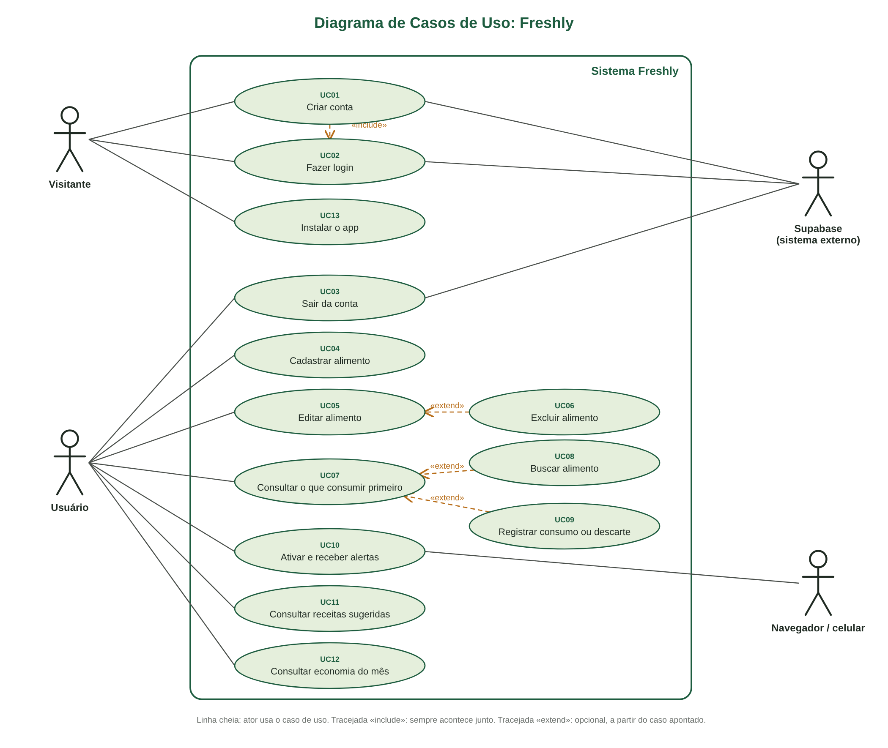

# 3. Atores e Casos de Uso

## 3.1 Definição dos Atores

Um ator é um papel desempenhado por uma pessoa, organização, equipamento ou outro sistema que interage com o sistema.

| Ator | Tipo | Descrição |
|---|---|---|
| **Visitante** | Pessoa | Quem abriu o app e ainda não entrou na conta. Pode criar conta, fazer login e instalar o app. |
| **Usuário** | Pessoa | Quem está logado. Cadastra e controla os alimentos, recebe alertas e vê receitas e economia. Exemplo: a persona Camila. |
| **Supabase** | Sistema externo | Serviço em nuvem que faz a autenticação (criar conta, login, sessão) e guarda os dados no banco PostgreSQL. |
| **Navegador / celular** | Sistema externo | Mostra as notificações de validade e permite instalar o app na tela inicial. |

## 3.2 Diagrama de Casos de Uso

Um caso de uso descreve uma funcionalidade que o sistema oferece para atender ao objetivo de um ator, ou seja, algo que o ator quer fazer por meio do sistema.

* **«include»:** o caso de uso sempre executa o outro junto. Ao criar a conta (UC01), o app já faz o login (UC02).
* **«extend»:** o caso de uso é opcional e começa a partir de outro. A partir da lista (UC07), o usuário pode buscar (UC08) ou registrar consumo ou descarte (UC09). A partir da edição (UC05), pode excluir (UC06).

| Código | Caso de uso | Ator principal | Requisitos |
|---|---|---|---|
| UC01 | Criar conta | Visitante | RF01 |
| UC02 | Fazer login | Visitante | RF02 |
| UC03 | Sair da conta | Usuário | RF03 |
| UC04 | Cadastrar alimento | Usuário | RF04, RF05, RF18 |
| UC05 | Editar alimento | Usuário | RF06 |
| UC06 | Excluir alimento | Usuário | RF07 |
| UC07 | Consultar o que consumir primeiro | Usuário | RF08, RF09, RF10, RF19 |
| UC08 | Buscar alimento | Usuário | RF11 |
| UC09 | Registrar consumo ou descarte | Usuário | RF12 |
| UC10 | Ativar e receber alertas de validade | Usuário | RF13 |
| UC11 | Consultar receitas sugeridas | Usuário | RF14, RF15 |
| UC12 | Consultar economia do mês | Usuário | RF16 |
| UC13 | Instalar o app | Visitante | RF17 |

## 3.3 Descrição dos Casos de Uso

### UC01: Criar conta

| Campo | Descrição |
|---|---|
| **Objetivo** | Permitir que o visitante crie uma conta para guardar os próprios alimentos. |
| **Requisitos** | RF01 |
| **Atores** | Visitante, Supabase |
| **Prioridade** | Alta |
| **Pré-condições** | Não estar logado. Ter conexão com a internet. |
| **Frequência de uso** | Uma vez por usuário |
| **Pós-condições** | Conta criada e usuário logado na tela Início. |
| **Campos** | Nome, e-mail e senha. |
| **Fluxo principal** | [P1] Sistema: apresenta a tela de login. [FA01] [P2] Visitante: toca em "Criar conta". [P3] Visitante: preenche nome, e-mail e senha. [RN01, RN02, RN03] [P4] Visitante: toca em "Criar minha conta". [P5] Sistema: valida os campos e envia ao Supabase. [FE01, FE02] [P6] Sistema: entra na conta automaticamente (UC02) e mostra a tela Início. [P7] Fim do caso de uso. |
| **Fluxo alternativo** | FA01: Visitante já tem conta. [P1] Visitante: toca em "Entrar" e segue o UC02. Fim do caso de uso. |
| **Fluxo de exceção** | FE01: Dados inválidos (nome vazio, e-mail sem "@" ou senha com menos de 6 caracteres). [P1] Sistema: mostra a mensagem do campo com problema. [P2] Sistema: retorna ao P3.  FE02: E-mail já cadastrado. [P1] Sistema: mostra "Este e-mail já tem conta. Toque em Entrar e use sua senha." [P2] Sistema: retorna ao P3. |
| **Validações** | [RN01] E-mail único, salvo em minúsculas. [RN02] Senha com no mínimo 6 caracteres. [RN03] Nome obrigatório. |
| **Protótipo de telas** | [02-criar-conta.png](img/prototipo/02-criar-conta.png) |
| **Autor(es)** | Christyan Assolini, Isabele Pires, Julia Lopes e Vitor Hugo Ramos |
| **Data** | 17/11/2026 |

### UC02: Fazer login

| Campo | Descrição |
|---|---|
| **Objetivo** | Permitir que o usuário entre na própria conta. |
| **Requisitos** | RF02 |
| **Atores** | Visitante, Supabase |
| **Prioridade** | Alta |
| **Pré-condições** | Ter uma conta criada. Ter conexão com a internet. |
| **Frequência de uso** | Baixa, porque a sessão fica salva no aparelho |
| **Pós-condições** | Usuário logado na tela Início. |
| **Campos** | E-mail e senha. |
| **Fluxo principal** | [P1] Sistema: apresenta a tela de login. [FA01] [P2] Visitante: preenche e-mail e senha. [P3] Visitante: toca em "Entrar". [P4] Sistema: valida as informações com o Supabase. [FE01, FE02] [P5] Sistema: libera o acesso e mostra a tela Início. [P6] Fim do caso de uso. |
| **Fluxo alternativo** | FA01: Visitante não tem conta. [P1] Visitante: toca em "Criar conta" e segue o UC01. Fim do caso de uso. |
| **Fluxo de exceção** | FE01: E-mail ou senha incorretos. [P1] Sistema: mostra "E-mail ou senha incorretos. Se ainda não tem conta, toque em Criar conta." [P2] Sistema: retorna ao P2.  FE02: Muitas tentativas seguidas. [P1] Sistema: pede para esperar 1 minuto e tentar de novo. |
| **Validações** | E-mail e senha obrigatórios. O ícone de olho mostra a senha digitada. |
| **Protótipo de telas** | [01-login.png](img/prototipo/01-login.png) |
| **Autor(es)** | Christyan Assolini, Isabele Pires, Julia Lopes e Vitor Hugo Ramos |
| **Data** | 17/11/2026 |

### UC03: Sair da conta

| Campo | Descrição |
|---|---|
| **Objetivo** | Encerrar a sessão no aparelho. |
| **Requisitos** | RF03 |
| **Atores** | Usuário, Supabase |
| **Prioridade** | Média |
| **Pré-condições** | Estar logado. |
| **Frequência de uso** | Baixa |
| **Pós-condições** | Sessão encerrada e tela de login exibida. |
| **Campos** | Não se aplica. |
| **Fluxo principal** | [P1] Usuário: abre a aba "Mais". [P2] Usuário: toca em "Sair da conta". [P3] Sistema: encerra a sessão e mostra a tela de login. [P4] Fim do caso de uso. |
| **Fluxo alternativo** | Não se aplica. |
| **Fluxo de exceção** | Não se aplica. |
| **Validações** | Não se aplica. |
| **Protótipo de telas** | [10-mais.png](img/prototipo/10-mais.png) |
| **Autor(es)** | Christyan Assolini, Isabele Pires, Julia Lopes e Vitor Hugo Ramos |
| **Data** | 17/11/2026 |

### UC04: Cadastrar alimento

| Campo | Descrição |
|---|---|
| **Objetivo** | Registrar um alimento que está em casa, com a validade. |
| **Requisitos** | RF04, RF05, RF18 |
| **Atores** | Usuário |
| **Prioridade** | Alta |
| **Pré-condições** | Estar logado. |
| **Frequência de uso** | Alta: a cada compra |
| **Pós-condições** | Alimento salvo como "ativo" e exibido na lista na faixa de prioridade certa. |
| **Campos** | Nome, quantidade, unidade (un, kg, g, L, ml, pacote), categoria, local (Geladeira, Freezer, Despensa), data de validade e preço pago (opcional). |
| **Fluxo principal** | [P1] Usuário: toca no botão "+". [P2] Sistema: apresenta a tela "Adicionar alimento". [P3] Usuário: preenche o nome e a quantidade. [P4] Usuário: escolhe categoria e local. [P5] Usuário: informa a validade, digitando ou tocando num atalho (Amanhã, 3 dias, 1 semana, 1 mês). [FA01] [P6] Usuário: informa o preço (opcional). [P7] Usuário: toca em "Salvar". [P8] Sistema: valida os campos e salva. [FE01, FE02] [P9] Sistema: mostra "Alimento salvo!" e volta para a tela anterior. [P10] Fim do caso de uso. |
| **Fluxo alternativo** | FA01: Ajustar a quantidade pelos botões. [P1] Usuário: toca em "−" ou "+" para mudar a quantidade. [P2] Sistema: retorna ao P5.  FA02: Adicionar alimentos de exemplo. [P1] Usuário: na aba "Mais", toca em "Adicionar alimentos de exemplo" e confirma. [P2] Sistema: cadastra uma lista pronta de alimentos. Fim do caso de uso. |
| **Fluxo de exceção** | FE01: Campo obrigatório vazio ou inválido. [P1] Sistema: mostra "Dê um nome ao alimento", "Informe a data de validade" ou "A quantidade precisa ser maior que zero". [P2] Sistema: retorna ao P3.  FE02: Sem conexão. [P1] Sistema: mostra "Não foi possível salvar. Confira sua internet e tente de novo." |
| **Validações** | [RN04] Nome, quantidade e validade obrigatórios. [RN05] Local entre as 3 opções. [RN06] Preço opcional e não negativo. |
| **Protótipo de telas** | [06-adicionar-alimento.png](img/prototipo/06-adicionar-alimento.png) |
| **Autor(es)** | Christyan Assolini, Isabele Pires, Julia Lopes e Vitor Hugo Ramos |
| **Data** | 17/11/2026 |

### UC05: Editar alimento

| Campo | Descrição |
|---|---|
| **Objetivo** | Corrigir ou atualizar os dados de um alimento. |
| **Requisitos** | RF06 |
| **Atores** | Usuário |
| **Prioridade** | Média |
| **Pré-condições** | Estar logado e ter o alimento cadastrado. |
| **Frequência de uso** | Média |
| **Pós-condições** | Dados atualizados e lista reordenada pela nova validade. |
| **Campos** | Os mesmos do UC04. |
| **Fluxo principal** | [P1] Usuário: toca num alimento da lista. [P2] Sistema: abre o painel de ações do alimento. [P3] Usuário: toca em "Editar". [P4] Sistema: apresenta o formulário preenchido. [P5] Usuário: altera os campos e toca em "Salvar". [FA01] [P6] Sistema: valida e salva. [FE01] [P7] Sistema: mostra "Alimento atualizado". [P8] Fim do caso de uso. |
| **Fluxo alternativo** | FA01: Excluir o alimento. [P1] Usuário: toca no ícone de lixeira e segue o UC06. |
| **Fluxo de exceção** | FE01: Igual ao FE01 do UC04. |
| **Validações** | [RN04, RN05, RN06] |
| **Protótipo de telas** | [04-acoes-alimento.png](img/prototipo/04-acoes-alimento.png), [06-adicionar-alimento.png](img/prototipo/06-adicionar-alimento.png) |
| **Autor(es)** | Christyan Assolini, Isabele Pires, Julia Lopes e Vitor Hugo Ramos |
| **Data** | 17/11/2026 |

### UC06: Excluir alimento

| Campo | Descrição |
|---|---|
| **Objetivo** | Apagar um alimento cadastrado por engano. |
| **Requisitos** | RF07 |
| **Atores** | Usuário |
| **Prioridade** | Baixa |
| **Pré-condições** | Estar na tela de edição do alimento (UC05). |
| **Frequência de uso** | Baixa |
| **Pós-condições** | Alimento apagado. Ele também deixa de contar nas estatísticas. |
| **Campos** | Não se aplica. |
| **Fluxo principal** | [P1] Usuário: toca no ícone de lixeira. [P2] Sistema: pergunta "Excluir este alimento? Ele some também das estatísticas." [FA01] [P3] Usuário: confirma. [P4] Sistema: apaga, mostra "Alimento excluído" e volta para a lista. [P5] Fim do caso de uso. |
| **Fluxo alternativo** | FA01: Usuário cancela. [P1] Sistema: não apaga nada e continua na edição. |
| **Fluxo de exceção** | FE01: Falha ao excluir. [P1] Sistema: mostra "Não foi possível excluir." |
| **Validações** | Exige confirmação. |
| **Protótipo de telas** | [06-adicionar-alimento.png](img/prototipo/06-adicionar-alimento.png) (no modo edição) |
| **Autor(es)** | Christyan Assolini, Isabele Pires, Julia Lopes e Vitor Hugo Ramos |
| **Data** | 17/11/2026 |

### UC07: Consultar o que consumir primeiro

| Campo | Descrição |
|---|---|
| **Objetivo** | Mostrar o que está em casa, do que vence primeiro ao que vence depois. |
| **Requisitos** | RF08, RF09, RF10, RF19 |
| **Atores** | Usuário |
| **Prioridade** | Alta |
| **Pré-condições** | Estar logado. |
| **Frequência de uso** | Alta: diária |
| **Pós-condições** | Não se aplica. |
| **Campos** | Filtro de local: Todos, Geladeira, Freezer, Despensa. |
| **Fluxo principal** | [P1] Usuário: abre o app. [P2] Sistema: mostra na tela Início os 5 alimentos que vencem primeiro e a economia do mês. [P3] Usuário: toca em "O que consumir primeiro?" ou na aba "Alimentos". [P4] Sistema: mostra os alimentos nas faixas Vencidos, Consumir agora, Em breve e Depois. [RN09] [P5] Usuário: escolhe um local no filtro. [FA01] [P6] Sistema: mostra só os alimentos daquele local. [P7] Fim do caso de uso. |
| **Fluxo alternativo** | FA01: Lista vazia. [P1] Sistema: mostra "Sua geladeira ainda está vazia por aqui" e o botão "Cadastrar primeiro alimento" (UC04). |
| **Fluxo de exceção** | FE01: Sem conexão. [P1] Sistema: mostra "Não foi possível carregar seus alimentos. Confira sua internet." |
| **Validações** | [RN08] Só aparecem alimentos com status "ativo". |
| **Protótipo de telas** | [03-inicio.png](img/prototipo/03-inicio.png), [05-alimentos.png](img/prototipo/05-alimentos.png) |
| **Autor(es)** | Christyan Assolini, Isabele Pires, Julia Lopes e Vitor Hugo Ramos |
| **Data** | 17/11/2026 |

### UC08: Buscar alimento

| Campo | Descrição |
|---|---|
| **Objetivo** | Encontrar rapidamente um alimento pelo nome. |
| **Requisitos** | RF11 |
| **Atores** | Usuário |
| **Prioridade** | Baixa |
| **Pré-condições** | Estar na tela Início. |
| **Frequência de uso** | Média: antes de ir ao mercado |
| **Pós-condições** | Não se aplica. |
| **Campos** | Texto de busca. |
| **Fluxo principal** | [P1] Usuário: digita no campo "Buscar alimento…". [P2] Sistema: mostra os alimentos ativos cujo nome contém o texto, ignorando acentos e maiúsculas. [P3] Fim do caso de uso. |
| **Fluxo alternativo** | FA01: Nada encontrado. [P1] Sistema: mostra "Nenhum alimento com esse nome." |
| **Fluxo de exceção** | Não se aplica. |
| **Validações** | Não se aplica. |
| **Protótipo de telas** | [03-inicio.png](img/prototipo/03-inicio.png) |
| **Autor(es)** | Christyan Assolini, Isabele Pires, Julia Lopes e Vitor Hugo Ramos |
| **Data** | 17/11/2026 |

### UC09: Registrar consumo ou descarte

| Campo | Descrição |
|---|---|
| **Objetivo** | Informar que o alimento foi consumido ou jogado fora, para tirar da lista e alimentar a economia do mês. |
| **Requisitos** | RF12 |
| **Atores** | Usuário |
| **Prioridade** | Alta |
| **Pré-condições** | Ter alimento ativo na lista. |
| **Frequência de uso** | Alta |
| **Pós-condições** | Status alterado para "consumido" ou "descartado", com data e hora registradas. |
| **Campos** | Não se aplica. |
| **Fluxo principal** | [P1] Usuário: toca num alimento da lista. [P2] Sistema: abre o painel com "Consumi", "Joguei fora" e "Editar". [P3] Usuário: toca em "Consumi". [FA01] [P4] Sistema: marca como consumido e mostra "Boa! Menos um desperdício 🌱". [P5] Sistema: tira o alimento da lista. [P6] Fim do caso de uso. |
| **Fluxo alternativo** | FA01: Alimento estragou. [P1] Usuário: toca em "Joguei fora". [P2] Sistema: marca como descartado e mostra "Registrado como descartado". |
| **Fluxo de exceção** | FE01: Falha ao salvar. [P1] Sistema: mostra "Não deu para salvar. Tente de novo." |
| **Validações** | [RN08] |
| **Protótipo de telas** | [04-acoes-alimento.png](img/prototipo/04-acoes-alimento.png) |
| **Autor(es)** | Christyan Assolini, Isabele Pires, Julia Lopes e Vitor Hugo Ramos |
| **Data** | 17/11/2026 |

### UC10: Ativar e receber alertas de validade

| Campo | Descrição |
|---|---|
| **Objetivo** | Avisar o usuário sobre alimentos vencidos ou que vencem em até 2 dias. |
| **Requisitos** | RF13 |
| **Atores** | Usuário, Navegador / celular |
| **Prioridade** | Alta |
| **Pré-condições** | Estar logado. No iPhone, o app precisa estar instalado na tela inicial. |
| **Frequência de uso** | Diária |
| **Pós-condições** | Notificação mostrada no aparelho. |
| **Campos** | Não se aplica. |
| **Fluxo principal** | [P1] Usuário: na aba "Mais", toca em "Ativar alertas". [P2] Navegador: pede permissão para mostrar notificações. [P3] Usuário: permite. [FE01] [P4] Sistema: mostra "Alertas ativados". [P5] A cada dia, ao abrir o app, o sistema confere os alimentos. [RN10] [P6] Sistema: se houver alimento vencido ou vencendo em até 2 dias, mostra a notificação, por exemplo "3 alimentos vencem logo. Alface, Leite, Tomate. Que tal consumir primeiro?". [P7] Fim do caso de uso. |
| **Fluxo alternativo** | FA01: Testar o alerta. [P1] Usuário: toca em "Testar alerta agora". [P2] Sistema: mostra a notificação na hora, ou "Nada vencendo agora 🎉". |
| **Fluxo de exceção** | FE01: Permissão negada ou navegador sem suporte. [P1] Sistema: explica como liberar nas configurações ou, no iPhone, pede para instalar o app primeiro. |
| **Validações** | [RN10] No máximo 1 alerta por dia em cada aparelho. |
| **Protótipo de telas** | [10-mais.png](img/prototipo/10-mais.png) |
| **Autor(es)** | Christyan Assolini, Isabele Pires, Julia Lopes e Vitor Hugo Ramos |
| **Data** | 17/11/2026 |

### UC11: Consultar receitas sugeridas

| Campo | Descrição |
|---|---|
| **Objetivo** | Sugerir o que cozinhar com o que vence primeiro. |
| **Requisitos** | RF14, RF15 |
| **Atores** | Usuário |
| **Prioridade** | Média |
| **Pré-condições** | Ter ao menos um alimento ativo e não vencido. |
| **Frequência de uso** | Média |
| **Pós-condições** | Não se aplica. |
| **Campos** | Filtro: Todas, Rápidas, Saudáveis, Fáceis. |
| **Fluxo principal** | [P1] Usuário: abre a aba "Receitas". [P2] Sistema: lista as receitas que usam os alimentos cadastrados, ordenadas por pontos. [RN11, RN12] [FA01] [P3] Usuário: escolhe um filtro (opcional). [P4] Usuário: toca numa receita. [P5] Sistema: mostra tempo, dificuldade, o que o usuário já tem em casa (com a validade), o que mais vai precisar e o modo de preparo. [P6] Fim do caso de uso. |
| **Fluxo alternativo** | FA01: Nenhuma receita encontrada. [P1] Sistema: mostra "Cadastre alguns alimentos para receber sugestões de receitas." |
| **Fluxo de exceção** | Não se aplica. |
| **Validações** | [RN11] Alimentos vencidos não entram. |
| **Protótipo de telas** | [07-receitas.png](img/prototipo/07-receitas.png), [08-detalhe-receita.png](img/prototipo/08-detalhe-receita.png) |
| **Autor(es)** | Christyan Assolini, Isabele Pires, Julia Lopes e Vitor Hugo Ramos |
| **Data** | 17/11/2026 |

### UC12: Consultar economia do mês

| Campo | Descrição |
|---|---|
| **Objetivo** | Mostrar quanto o usuário economizou e se está desperdiçando menos. |
| **Requisitos** | RF16 |
| **Atores** | Usuário |
| **Prioridade** | Média |
| **Pré-condições** | Estar logado. |
| **Frequência de uso** | Semanal |
| **Pós-condições** | Não se aplica. |
| **Campos** | Não se aplica. |
| **Fluxo principal** | [P1] Usuário: abre a aba "Economia". [P2] Sistema: calcula e mostra os alimentos salvos do desperdício, o valor economizado e os consumidos no prazo. [RN13, RN14] [P3] Sistema: mostra o gráfico comparando os descartes do mês passado com os deste mês. [RN15] [P4] Fim do caso de uso. |
| **Fluxo alternativo** | FA01: Ainda sem dados. [P1] Sistema: mostra R$ 0 e "Marque o que você consumiu para ver sua economia aqui." |
| **Fluxo de exceção** | Não se aplica. |
| **Validações** | [RN13] Alimento sem preço conta como R$ 0. |
| **Protótipo de telas** | [09-economia.png](img/prototipo/09-economia.png) |
| **Autor(es)** | Christyan Assolini, Isabele Pires, Julia Lopes e Vitor Hugo Ramos |
| **Data** | 17/11/2026 |

### UC13: Instalar o app

| Campo | Descrição |
|---|---|
| **Objetivo** | Colocar o Freshly na tela inicial do celular, como um app, sem loja. |
| **Requisitos** | RF17 |
| **Atores** | Visitante, Navegador / celular |
| **Prioridade** | Média |
| **Pré-condições** | Abrir o link do app no Chrome (Android) ou no Safari (iPhone). |
| **Frequência de uso** | Uma vez por aparelho |
| **Pós-condições** | Ícone do Freshly na tela inicial. O app abre em tela cheia. |
| **Campos** | Não se aplica. |
| **Fluxo principal** | [P1] Visitante: abre o link do app. [P2] Visitante: no menu do navegador (⋮ no Android, Compartilhar no iPhone), toca em "Instalar app" ou "Adicionar à Tela de Início". [FA01] [P3] Navegador: pede confirmação e adiciona o ícone na tela inicial. [P4] Fim do caso de uso. |
| **Fluxo alternativo** | FA01: Instalar pelo próprio app (já logado). [P1] Usuário: abre a aba "Mais". [P2] Sistema: no Android, mostra o botão "Instalar Freshly"; no iPhone, mostra o passo a passo do Compartilhar. [P3] Usuário: segue a orientação e o sistema retorna ao P3. |
| **Fluxo de exceção** | Não se aplica. |
| **Validações** | Se o app já estiver instalado, a seção não aparece. |
| **Protótipo de telas** | [10-mais.png](img/prototipo/10-mais.png) |
| **Autor(es)** | Christyan Assolini, Isabele Pires, Julia Lopes e Vitor Hugo Ramos |
| **Data** | 17/11/2026 |
