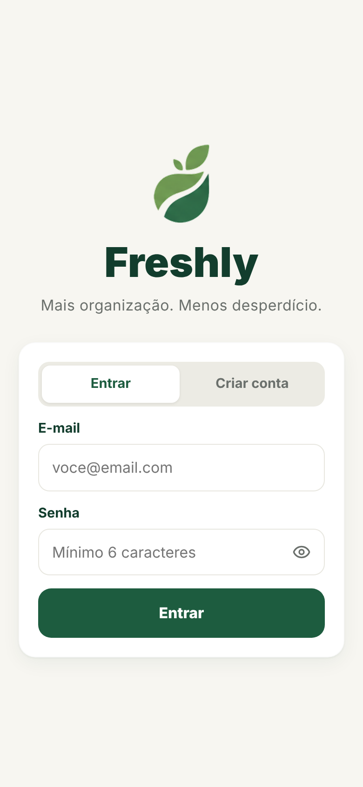
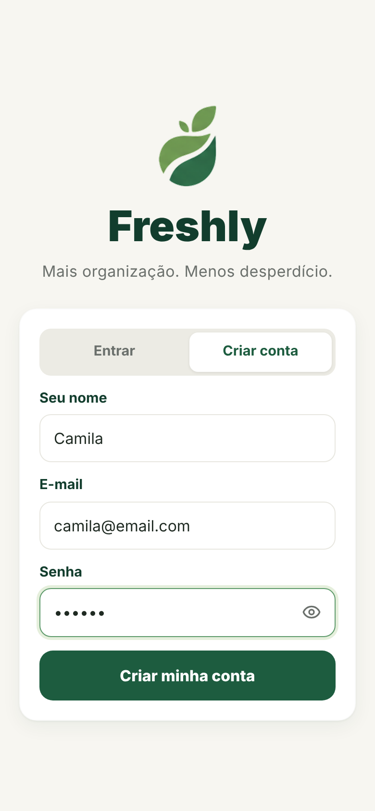
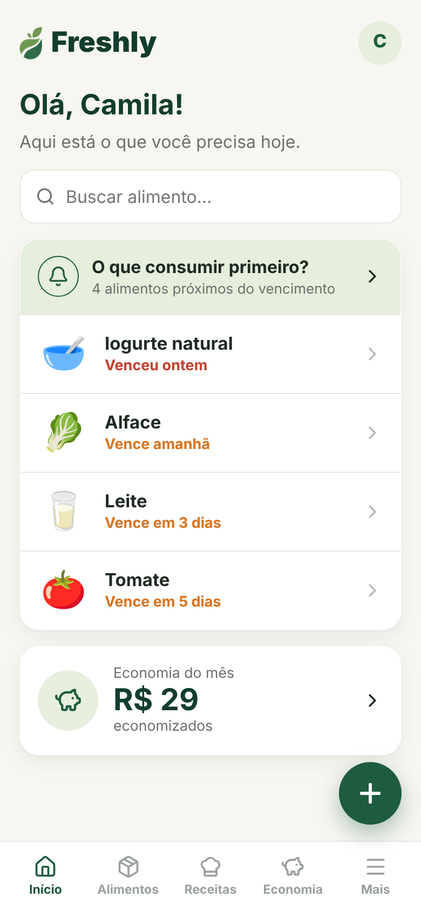
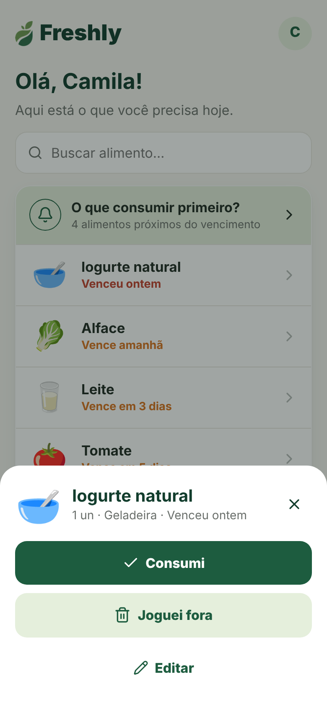
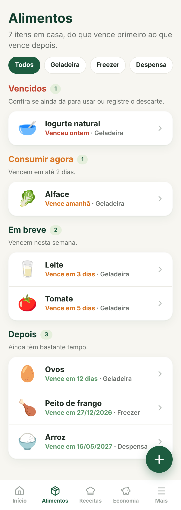
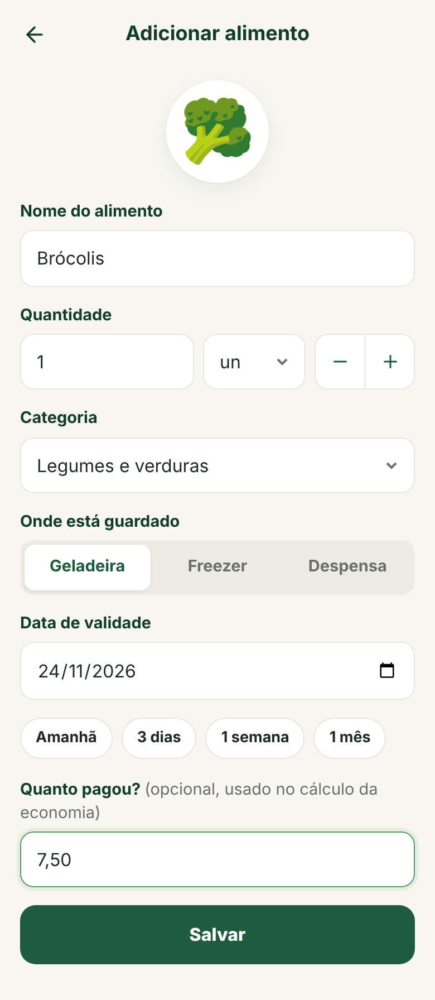
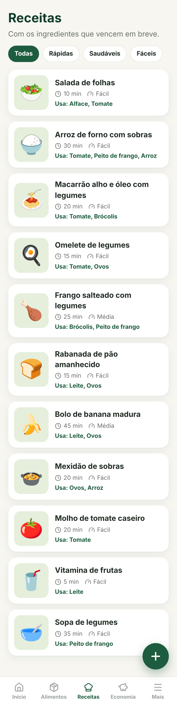
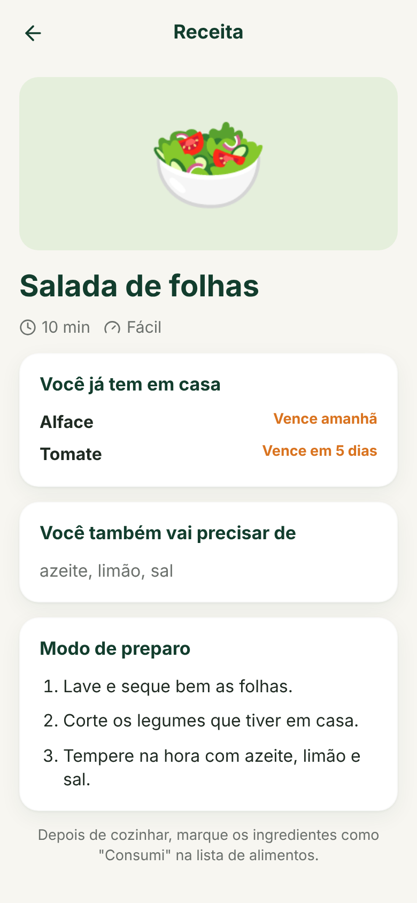
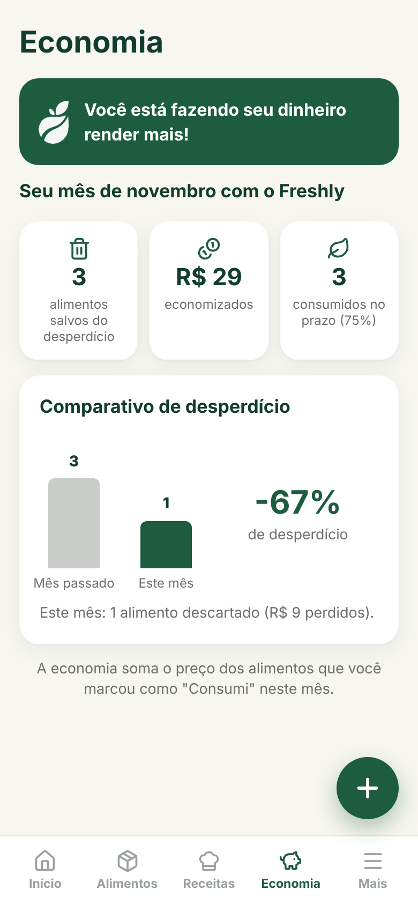
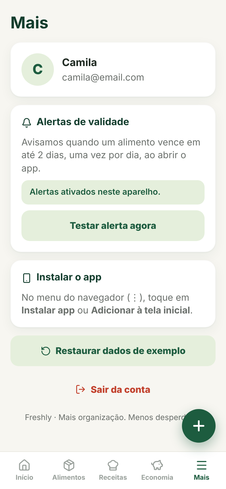

# 4. Protótipo de Telas

As telas abaixo são capturas do próprio app funcionando, em tamanho de celular (390 × 844 px). Elas servem como protótipo de alta fidelidade e mostram exatamente o que o usuário vê.

**Identidade visual**

| Item | Valor |
|---|---|
| Cor principal | Verde `#1D5C3F` |
| Verde claro (destaques) | `#E5EFDC` |
| Fundo | Creme `#F7F6F1` |
| Alerta (vence logo) | Laranja `#D9731F` |
| Vencido | Vermelho `#C2412D` |
| Fontes | Lato (títulos) e Nunito Sans (textos) |
| Ícones | Lucide e emojis dos alimentos |

**Navegação:** barra de abas embaixo (Início, Alimentos, Receitas, Economia, Mais) e botão verde "+" fixo para cadastrar um alimento de qualquer tela.

## Telas

| Login | Criar conta | Início |
|:---:|:---:|:---:|
|  |  |  |
| UC02 | UC01 | UC07, UC08, UC12 |

| Ações do alimento | Alimentos | Adicionar alimento |
|:---:|:---:|:---:|
|  |  |  |
| UC05, UC09 | UC07 | UC04, UC05, UC06 |

| Receitas | Detalhe da receita | Economia |
|:---:|:---:|:---:|
|  |  |  |
| UC11 | UC11 | UC12 |

| Mais |
|:---:|
|  |
| UC03, UC10, UC13 |

## O que cada tela faz

1. **Login:** entrar com e-mail e senha. O ícone de olho mostra a senha.
2. **Criar conta:** nome, e-mail e senha. Depois de criar, já entra direto.
3. **Início:** saudação, busca, os alimentos que vencem primeiro e o resumo da economia do mês.
4. **Ações do alimento:** painel que sobe ao tocar num item, com "Consumi", "Joguei fora" e "Editar".
5. **Alimentos:** lista completa em faixas (vencidos, consumir agora, em breve, depois) com filtro por local.
6. **Adicionar alimento:** formulário com atalhos de validade e ícone que muda conforme o nome digitado.
7. **Receitas:** sugestões ordenadas pelo que vence primeiro, com filtros.
8. **Detalhe da receita:** o que já tem em casa, o que mais vai precisar e o modo de preparo.
9. **Economia:** alimentos salvos, valor economizado, consumidos no prazo e comparativo com o mês passado.
10. **Mais:** perfil, alertas de validade, instalação do app, alimentos de exemplo e sair.

> As telas foram capturadas com os alimentos de exemplo. Para gerar de novo, rode o app com `npm run dev` e cadastre os exemplos na aba **Mais**.
