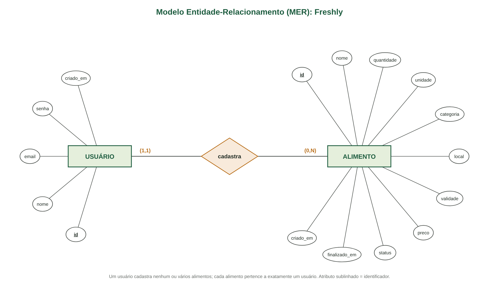
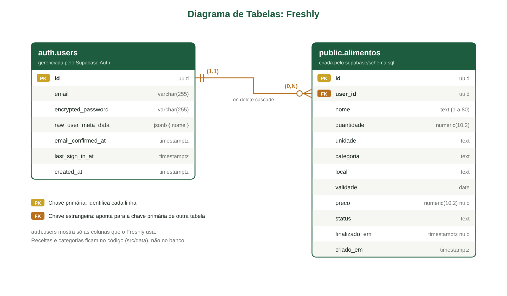

# 5. Projeto: Banco de Dados

O Freshly usa o **PostgreSQL 17**, hospedado no **Supabase** (plano gratuito). O Supabase já traz pronta a tabela de usuários (`auth.users`), que cuida de cadastro, login e senha criptografada. O Freshly cria só a tabela `alimentos`.

As receitas, categorias, unidades e locais não ficam no banco. São listas fixas no código (`src/data`), porque são iguais para todos os usuários e não mudam com o uso.

## 5.1 Diagrama do Modelo Entidade-Relacionamento (MER)

Modelo conceitual, na notação de Chen: entidade é retângulo, relacionamento é losango e atributo é elipse (o atributo sublinhado é o identificador).



**Leitura:** um **usuário** cadastra **nenhum ou vários** alimentos (0,N), e cada **alimento** pertence a **exatamente um** usuário (1,1). É um relacionamento de **um para muitos (1:N)**.

## 5.2 Diagrama de Tabelas (Chave Primária e Chave Estrangeira)

Modelo físico, com as tabelas como estão no banco.



* **Chave primária (PK):** coluna que identifica cada linha sem repetir. Nas duas tabelas é o `id`, do tipo `uuid` (um código aleatório e único, como `954763c4-f909-...`).
* **Chave estrangeira (FK):** coluna que aponta para a chave primária de outra tabela. `alimentos.user_id` aponta para `auth.users.id` e é isso que liga cada alimento ao seu dono.
* **on delete cascade:** se o usuário for apagado, os alimentos dele são apagados junto, para não sobrar alimento "sem dono".

## 5.3 Dicionário de Dados

### TABELA: ALIMENTOS (`public.alimentos`)

Cada linha é um alimento que o usuário cadastrou.

| Chave | Campo | Descrição | Tipo | Tam | Dec | Obrig. | Padrão / Restrição |
|:---:|---|---|---|:---:|:---:|:---:|---|
| PK | `id` | Código único do alimento | UUID | 36 | - | Sim | Gerado automaticamente (`gen_random_uuid()`) |
| FK | `user_id` | Código do usuário dono do alimento | UUID | 36 | - | Sim | Usuário logado (`auth.uid()`); referencia `auth.users(id)`, apaga em cascata |
| | `nome` | Nome do alimento (ex.: Tomate) | TEXTO | 80 | - | Sim | Entre 1 e 80 caracteres |
| | `quantidade` | Quantidade em casa | NUMÉRICO | 10 | 2 | Sim | Padrão 1; maior que 0 |
| | `unidade` | Unidade da quantidade | TEXTO | - | - | Sim | Padrão `un`; opções no app: un, kg, g, L, ml, pacote |
| | `categoria` | Tipo do alimento | TEXTO | - | - | Sim | Padrão `Outros`; opções no app: Frutas, Legumes e verduras, Laticínios, Carnes, Grãos e massas, Bebidas, Congelados, Sobras, Outros |
| | `local` | Onde está guardado | TEXTO | - | - | Sim | Padrão `Geladeira`; só aceita `Geladeira`, `Freezer` ou `Despensa` |
| | `validade` | Data de validade | DATA | - | - | Sim | Formato AAAA-MM-DD |
| | `preco` | Quanto o usuário pagou | NUMÉRICO | 10 | 2 | Não | Nulo ou maior ou igual a 0 |
| | `status` | Situação do alimento | TEXTO | - | - | Sim | Padrão `ativo`; só aceita `ativo`, `consumido` ou `descartado` |
| | `finalizado_em` | Data e hora em que foi consumido ou descartado | DATA E HORA | - | - | Não | Nulo enquanto o alimento está ativo |
| | `criado_em` | Data e hora do cadastro | DATA E HORA | - | - | Sim | Padrão `now()` (agora) |

**Índice:** `alimentos_user_validade_idx` em (`user_id`, `status`, `validade`). Deixa rápida a consulta mais comum do app, que é buscar os alimentos ativos de um usuário ordenados pela validade.

### TABELA: USUÁRIOS (`auth.users`, gerenciada pelo Supabase)

Mostramos só as colunas que o Freshly usa.

| Chave | Campo | Descrição | Tipo | Tam | Dec | Obrig. | Observação |
|:---:|---|---|---|:---:|:---:|:---:|---|
| PK | `id` | Código único do usuário | UUID | 36 | - | Sim | Gerado pelo Supabase |
| | `email` | E-mail de acesso | TEXTO | 255 | - | Sim | Único; o app salva em minúsculas |
| | `encrypted_password` | Senha criptografada (hash bcrypt) | TEXTO | 255 | - | Sim | A senha original nunca é guardada |
| | `raw_user_meta_data` | Dados extras do perfil | JSON | - | - | Não | Guarda o `nome` informado no cadastro |
| | `email_confirmed_at` | Quando o e-mail foi confirmado | DATA E HORA | - | - | Não | Nulo se não confirmado |
| | `last_sign_in_at` | Último login | DATA E HORA | - | - | Não | |
| | `created_at` | Data de criação da conta | DATA E HORA | - | - | Sim | |

**Correspondência de tipos:** UUID = `uuid`; TEXTO = `text` (sem tamanho fixo, por isso "-" em Tam) ou `varchar`; NUMÉRICO = `numeric(10,2)` (10 dígitos, 2 depois da vírgula); DATA = `date`; DATA E HORA = `timestamptz` (com fuso horário); JSON = `jsonb`.

## 5.4 Implementação do Banco no SGBD

* **SGBD:** PostgreSQL 17, no Supabase (região us-east-1).
* **Script:** [`supabase/schema.sql`](../supabase/schema.sql). Ele cria a tabela, as restrições, o índice e as regras de segurança. Pode ser rodado mais de uma vez sem erro.
* **Como aplicar:** no Supabase, abrir **SQL Editor → New query**, colar o script e clicar em **Run**.

### Segurança por linha (RLS)

O app conversa com o banco direto do navegador, usando a chave pública do Supabase. Para ninguém ler os dados dos outros, a tabela tem **RLS (Row Level Security)** ligada, com 4 regras:

| Regra | Operação | Condição |
|---|---|---|
| `dono le` | SELECT (ler) | `user_id = auth.uid()` |
| `dono insere` | INSERT (inserir) | `user_id = auth.uid()` |
| `dono altera` | UPDATE (alterar) | `user_id = auth.uid()` |
| `dono apaga` | DELETE (apagar) | `user_id = auth.uid()` |

`auth.uid()` devolve o código do usuário logado. Então, mesmo que alguém altere o código do app no navegador, o banco só devolve e só aceita as linhas daquele usuário.

### Exemplos de consultas

```sql
-- Lista de alimentos do usuário logado, do que vence primeiro ao que vence depois
select * from alimentos order by validade;

-- Registrar consumo (UC09)
update alimentos set status = 'consumido', finalizado_em = now() where id = :id;

-- Economia do mês (UC12). O app faz esta conta em src/lib/calculos.js;
-- em SQL, a consulta equivalente seria:
select coalesce(sum(preco), 0) as economizado
from alimentos
where status = 'consumido'
  and date_trunc('month', finalizado_em) = date_trunc('month', now());
```

Os filtros por usuário não aparecem nas consultas porque o RLS já aplica `user_id = auth.uid()` automaticamente.
