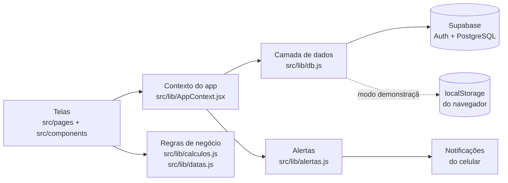

# 6. Implementação

## 6.1 Codificação do sistema: linguagem

| Parte | Linguagem |
|---|---|
| Telas e regras de negócio | **JavaScript** (ES2022), com **JSX** (o jeito do React de escrever HTML dentro do JavaScript) |
| Visual | **CSS** puro, com variáveis de cor |
| Banco de dados | **SQL** (PostgreSQL) |
| Testes | JavaScript com **Vitest** |

**Por que JavaScript:** o Freshly é um PWA, ou seja, roda no navegador do celular. O navegador só executa JavaScript, então usamos a mesma linguagem no app inteiro. Isso também deixa o time trabalhar em uma linguagem só.

## 6.2 Frameworks e bibliotecas

| Tecnologia | Para que serve no Freshly |
|---|---|
| **React 19** | Monta as telas em componentes (pedaços reaproveitáveis, como a linha de um alimento) e atualiza a tela sozinho quando os dados mudam. |
| **Vite 8** | Roda o app no computador durante o desenvolvimento e gera a versão final otimizada (`npm run build`). |
| **React Router 7** | Troca de tela pelo endereço (`/`, `/alimentos`, `/receitas/:id`...). |
| **Supabase JS 2** | Biblioteca que conversa com o Supabase: login, sessão e leitura e gravação no banco. |
| **vite-plugin-pwa (Workbox)** | Gera o manifesto (nome, ícone e cores do app instalado) e o service worker, que guarda o app para abrir sem internet. |
| **Lucide React** | Ícones das telas. |
| **Vitest 5** | Testes automáticos das regras de negócio. |
| **Oxlint** | Aponta erros comuns no código (lint). |

## 6.3 Arquitetura

O app é dividido em camadas. Cada camada só conversa com a camada vizinha:



| Camada | Arquivos | Responsabilidade |
|---|---|---|
| Telas | `src/pages/*.jsx`, `src/components/*.jsx` | Mostrar os dados e receber os toques do usuário. Não falam direto com o banco. |
| Contexto | `src/lib/AppContext.jsx` | Guarda quem está logado e a lista de alimentos, e oferece as ações (adicionar, atualizar, marcar, excluir) para qualquer tela. |
| Regras de negócio | `src/lib/calculos.js`, `src/lib/datas.js`, `src/data/*` | Faixas de prioridade, receitas sugeridas, economia do mês e contas com datas. São funções puras, fáceis de testar. |
| Dados | `src/lib/db.js` | **Único** arquivo que fala com o Supabase. Se um dia trocarmos o banco, só ele muda. |
| Alertas | `src/lib/alertas.js` | Pede permissão e mostra a notificação de validade, no máximo uma vez por dia. |

## 6.4 Integração com o banco de dados e as telas

Exemplo do caminho completo quando o usuário toca em **"Consumi"** (UC09):

1. A tela `ItemAlimento.jsx` chama `marcar(id, 'consumido')`, que vem do contexto (`useApp()`).
2. O contexto chama `db.marcarComo(id, 'consumido')`.
3. O `db.js` envia ao Supabase: `update alimentos set status = 'consumido', finalizado_em = agora where id = ...`.
4. O banco confere a regra de segurança (RLS): o alimento precisa ser do usuário logado.
5. O Supabase devolve a linha atualizada, o contexto troca o item na lista e o React redesenha as telas. O alimento some da lista e a economia do mês já aparece atualizada.

**Login e sessão:** o Supabase Auth devolve um token de acesso (JWT), que a biblioteca guarda no navegador e renova sozinha. Por isso o usuário não precisa entrar de novo toda vez.

**Modo demonstração:** se o arquivo `.env` não tiver as chaves do Supabase, o `db.js` passa a guardar tudo no `localStorage` do navegador, com uma lista de exemplo. Serve para apresentar ou desenvolver sem internet.

## 6.5 Estrutura de pastas

```
freshly/
├── docs/                 documentação do projeto (esta pasta)
├── public/               ícones do app instalado
├── src/
│   ├── pages/            uma tela por arquivo
│   ├── components/       pedaços reaproveitados (abas, linha de alimento, cabeçalho)
│   ├── lib/              contexto, dados, regras e alertas
│   │   └── __tests__/    testes automáticos
│   ├── data/             categorias, emojis e receitas
│   └── estilos.css       visual do app
├── supabase/schema.sql   script do banco
├── vite.config.js        configuração do Vite e do PWA
└── package.json          dependências e comandos
```

## 6.6 Como rodar no computador

Precisa do **Node.js 20** ou mais novo.

```bash
npm install        # instala as dependências
npm run dev        # abre o app em http://localhost:5173
npm test           # roda os testes automáticos
npm run lint       # procura erros no código
npm run build      # gera a versão final na pasta dist/
```

Para usar o banco de verdade, copie o `.env.example` para `.env` e preencha `VITE_SUPABASE_URL` e `VITE_SUPABASE_KEY`. Sem esse arquivo, o app abre no modo demonstração.
