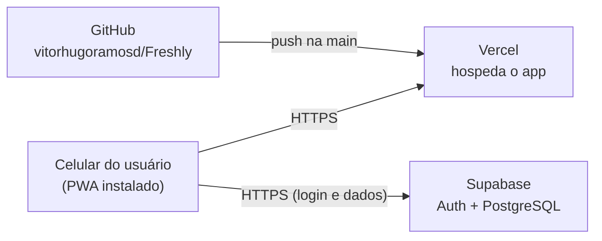

# 8. Implantação

## 8.1 Ambientes

| Ambiente | Onde | Para quê |
|---|---|---|
| Desenvolvimento | Computador do dev (`npm run dev`) | Programar e testar; sem `.env` roda no modo demonstração |
| Produção | **https://freshly-blond.vercel.app** | App publicado, usado pelos usuários e na apresentação |

## 8.2 Infraestrutura (toda gratuita)

| Serviço | Plano | Papel |
|---|---|---|
| **GitHub** | Free | Guarda o código e o histórico de versões |
| **Vercel** | Hobby | Gera e publica o app a cada mudança na branch `main` |
| **Supabase** | Free | Login dos usuários e banco PostgreSQL |

## 8.3 Como publicar (passo a passo)

### Banco (uma vez só)

1. Criar o projeto no [Supabase](https://supabase.com).
2. Em **SQL Editor → New query**, rodar o [`supabase/schema.sql`](../supabase/schema.sql).
3. Em **Authentication → Sign In / Providers → Email**, desligar **Confirm email**, para a pessoa entrar logo depois de criar a conta.
4. Em **Authentication → URL Configuration**, colocar o endereço da Vercel em **Site URL**.

### App

1. Na [Vercel](https://vercel.com), importar o repositório do GitHub (**Add New → Project**).
2. Em **Environment Variables**, cadastrar como **Config**:
   * `VITE_SUPABASE_URL` com a URL do projeto Supabase
   * `VITE_SUPABASE_KEY` com a chave pública (publishable)
3. Clicar em **Deploy**. O `vercel.json` faz todas as rotas abrirem o app (por exemplo `/receitas/omelete`).

A partir daí, **todo push na `main` publica sozinho** em cerca de 1 minuto.

> A chave publishable pode ficar no app sem problema: ela é feita para o navegador. Quem protege os dados é o RLS no banco. Nunca coloque a chave `secret` ou `service_role` no app.

## 8.4 Instalação no celular

* **Android (Chrome):** abrir o link e tocar em **Instalar app** (ou menu ⋮ → Adicionar à tela inicial).
* **iPhone (Safari):** abrir o link, tocar em **Compartilhar** e depois em **Adicionar à Tela de Início**.

Dica para a apresentação: gerar um QR code do link e colocar no último slide.

## 8.5 Voltar uma versão (rollback)

Se uma publicação der problema, na Vercel abrir **Deployments**, escolher a versão anterior que funcionava e clicar em **Instant Rollback**. O app volta na hora, sem mexer no código.

## 8.6 Cuidados com o plano gratuito

| Situação | O que fazer |
|---|---|
| **Supabase pausa o projeto depois de alguns dias sem uso.** O app abre, mas não carrega dados nem faz login. | No painel do Supabase, abrir o projeto e clicar em **Restore project**. Leva alguns minutos. Fazer isso **um dia antes da apresentação**. |
| Limite de e-mails do Supabase (poucos por hora). | Manter **Confirm email** desligado. |
| Vercel Hobby é para uso não comercial. | Adequado para o projeto acadêmico; se virar produto, migrar para o plano Pro. |

## 8.7 Checklist antes de publicar

- [ ] `npm test` passando
- [ ] `npm run lint` sem erros
- [ ] `npm run build` gerando a pasta `dist/` sem erro
- [ ] Projeto do Supabase **ativo** (não pausado)
- [ ] Casos de teste manuais executados no celular ([07-testes.md](07-testes.md))
